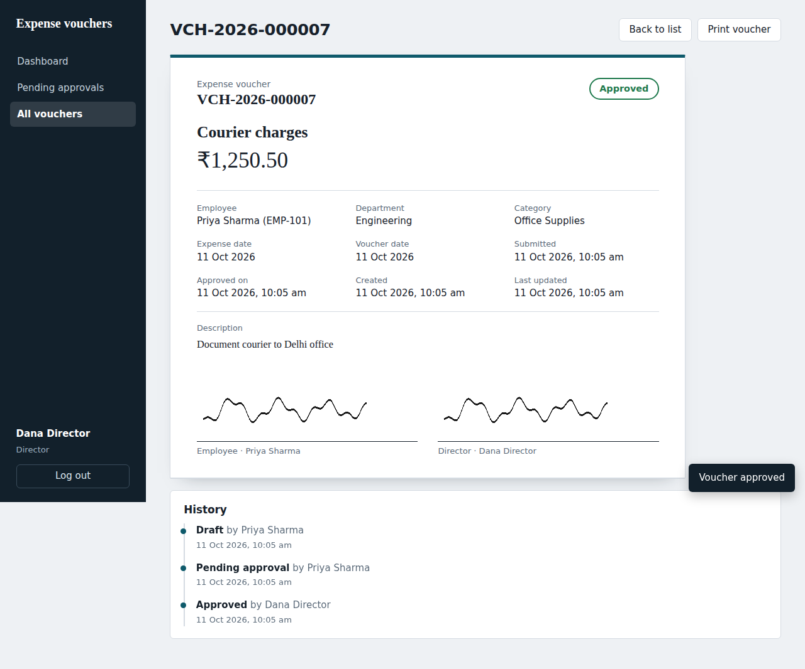

# Expense Voucher Management System

A web application that replaces ABC Company's manual expense-voucher process. Employees create and submit vouchers, the Director approves (with a signature) or rejects (with a reason), and the Accounts Team gets a read-only view of everything for reimbursement.

| Layer | Choice |
|---|---|
| Frontend | React 18, React Router 6, Vite, Axios (plain CSS, responsive) |
| Backend | Node.js, Express, JWT, Zod validation, Multer uploads |
| Database | PostgreSQL 14+ |
| Tests | Jest + Supertest (integration tests against a real Postgres) |



More screenshots are in [`docs/screenshots`](docs/screenshots).

---

## 1. Quick start

**Prerequisites:** Node 18+, PostgreSQL running locally.

```bash
# 1. Create the database
createdb expense_vouchers            # or: psql -c "CREATE DATABASE expense_vouchers;"

# 2. Backend
cd backend
cp .env.example .env                 # edit DATABASE_URL and JWT_SECRET if needed
npm install
npm run migrate                      # applies migrations/*.sql
npm run seed -- --demo               # demo users + sample vouchers (omit --demo for users only)
npm run dev                          # http://localhost:4000

# 3. Frontend (new terminal)
cd frontend
npm install
npm run dev                          # http://localhost:5173  (proxies /api to :4000)
```

### Demo accounts (password for all: `Password@123`)

| Role | Email |
|---|---|
| Employee | `priya@abc.com`, `rahul@abc.com` |
| Director | `director@abc.com` |
| Accounts | `accounts@abc.com` |

The login page has one-click buttons that fill these in.

### Run the tests

```bash
cd backend
createdb expense_vouchers_test       # a separate database; tests reset it every run
npm test
```

Set `TEST_DATABASE_URL` if your Postgres credentials differ from the defaults.

### Environment variables

`backend/.env.example` documents every variable (`PORT`, `DATABASE_URL`, `JWT_SECRET`, `JWT_EXPIRES_IN`, `CLIENT_ORIGIN`, `UPLOAD_DIR`, `MAX_UPLOAD_MB`). `frontend/.env.example` only has `VITE_API_URL`, which is needed only if the API is on another origin.

---

## 2. Project structure

```
backend/
  migrations/001_init.sql        schema (enums, tables, constraints, indexes)
  src/
    app.js / server.js           Express app and entry point
    routes/                      thin HTTP layer: auth, users, vouchers, dashboard, meta
    services/                    business logic: voucherService (workflow), dashboardService
    middleware/                  auth + role guard, upload, error handler
    validators.js                Zod schemas (create/update, approve, reject, list filters)
    scripts/                     migrate, seed, signature PNG generator
  tests/voucher.test.js          28 integration tests
frontend/
  src/pages/                     Login, Dashboard, VoucherForm, VoucherList, VoucherDetail
  src/components/                Layout, ProtectedRoute, SignaturePicker, SecureImage, ...
```

---

## 3. Database schema

```
users 1 ──< vouchers >── 1 users            (employee_id, director_id)
                │
                └──< voucher_events >── 1 users   (audit trail, actor_id)
```

### `users`
| Column | Notes |
|---|---|
| `id`, `name`, `email` (unique), `password_hash` | passwords are bcrypt-hashed |
| `role` | enum `EMPLOYEE \| DIRECTOR \| ACCOUNTS` |
| `employee_code`, `department` | optional (Employee ID is optional in the spec) |
| `signature_path` | optional saved signature, reused on future vouchers |

### `vouchers`
| Column | Notes |
|---|---|
| `voucher_number` | unique, auto-generated: `VCH-<year>-<6-digit sequence>` from `voucher_number_seq` |
| `voucher_date`, `expense_date` | `voucher_date` defaults to the creation date |
| `department`, `title`, `category`, `description`, `amount` | `amount NUMERIC(12,2) CHECK (amount > 0)` |
| `employee_id`, `employee_signature_path` | creator and their signature |
| `status` | enum `DRAFT \| PENDING_APPROVAL \| APPROVED \| REJECTED` |
| `submitted_at`, `approved_at`, `rejected_at` | workflow timestamps |
| `director_id`, `director_signature_path`, `rejection_reason` | approval details |
| `created_at`, `updated_at` | audit columns |

The database itself backs up the most important business rules with CHECK constraints, so even a buggy code path can't violate them:
- a non-draft voucher must have an employee signature
- an approved voucher must have a director signature
- a rejected voucher must have a non-empty rejection reason
- `amount > 0`

### `voucher_events`
One row per status change (`from_status`, `to_status`, `actor_id`, `note`, `created_at`). It feeds the History timeline on the voucher page and the Director's "Recent voucher activity".

### Workflow

```
DRAFT ──submit──> PENDING_APPROVAL ──approve──> APPROVED   (read-only)
                         └────────reject──────> REJECTED   (read-only, reason visible to employee)
```

The allowed transitions live in one table (`TRANSITIONS` in `src/constants.js`) and every state change goes through `assertTransition()` in `voucherService.js`. Each change runs in a transaction with a row lock (`SELECT ... FOR UPDATE`), so two simultaneous approvals can't both succeed.

---

## 4. API documentation

Base URL: `http://localhost:4000/api`. All routes except `/auth/login` and `/health` need `Authorization: Bearer <token>`.

Errors are always JSON: `{ "error": "message", "fields": { "fieldName": "message" } }` (`fields` only for validation errors).

| Status | Meaning |
|---|---|
| 400 | Validation failed or bad input |
| 401 | Missing, invalid or expired token |
| 403 | Role is not allowed to use this endpoint |
| 404 | Not found, **or not visible to you** (so IDs of other people's vouchers are never confirmed) |
| 409 | Action not allowed in the voucher's current status (e.g. editing a submitted voucher) |

### Auth
| Method | Path | Role | Description |
|---|---|---|---|
| POST | `/auth/login` | public | Body `{ email, password }` → `{ token, user }`. Rate-limited. |
| GET | `/auth/me` | any | Current user |

### Vouchers
| Method | Path | Role | Description |
|---|---|---|---|
| GET | `/vouchers` | any | List with search, filters, sort, pagination (below) |
| POST | `/vouchers` | Employee | Create a **Draft**. `multipart/form-data` |
| GET | `/vouchers/:id` | any (scoped) | Full details plus status history |
| PUT | `/vouchers/:id` | Employee (owner) | Edit a **Draft**. `multipart/form-data` |
| DELETE | `/vouchers/:id` | Employee (owner) | Delete a **Draft** → 204 |
| POST | `/vouchers/:id/submit` | Employee (owner) | Draft → Pending approval. Needs a signature. |
| POST | `/vouchers/:id/approve` | Director | `multipart`: `signature` file, or `useSavedSignature=true` |
| POST | `/vouchers/:id/reject` | Director | JSON `{ "reason": "..." }` (required) |
| GET | `/vouchers/:id/signature/:type` | any (scoped) | `type` is `employee` or `director`; returns the image |

**Create / update fields** (multipart): `department`*, `title`*, `category`* (one of the configured categories), `expenseDate`* (`YYYY-MM-DD`, not in the future), `amount`* (> 0, max 2 decimals), `description`, `signature` (PNG/JPG/WEBP, max 2 MB).

**List query parameters**

| Param | Description |
|---|---|
| `q` | matches voucher number, title or employee name |
| `status`, `category` | exact match |
| `department`, `employeeName` | partial, case-insensitive (`employeeName` ignored for employees) |
| `dateFrom`, `dateTo` | expense-date range |
| `minAmount`, `maxAmount` | amount range |
| `sortBy` | `voucherNumber, expenseDate, voucherDate, amount, status, employeeName, department, updatedAt, createdAt` |
| `order` | `asc` or `desc` (default `desc`) |
| `page`, `limit` | default 1 and 10, limit max 100 |

Response: `{ "data": [ ...vouchers ], "meta": { "page", "limit", "total", "totalPages", "totalAmount" } }`

Example:
```bash
curl "http://localhost:4000/api/vouchers?status=APPROVED&minAmount=1000&sortBy=amount&order=desc" \
  -H "Authorization: Bearer $TOKEN"
```

### Other
| Method | Path | Role | Description |
|---|---|---|---|
| GET | `/dashboard` | any | Role-specific metrics (exactly the lists in section 8 of the brief) |
| GET | `/meta` | any | Categories, statuses, known departments (for dropdowns) |
| POST | `/users/me/signature` | any | Save a reusable signature on your profile |
| GET | `/users/me/signature` | any | Fetch your saved signature |
| GET | `/health` | public | Liveness check |

---

## 5. How the business rules are enforced

| Rule | Where |
|---|---|
| Unique, auto-generated voucher numbers | Postgres sequence + `UNIQUE` constraint |
| New vouchers start as Draft | `status` default + `create()` |
| Edit/delete only while Draft; read-only after submit and after approval | `lockOwnDraft()` returns 409 otherwise |
| Only the Director approves/rejects | `requireRole('DIRECTOR')` + transition table |
| Employee signature mandatory to submit | `submit()` + DB CHECK |
| Director signature mandatory to approve | `approve()` + DB CHECK |
| Rejection reason mandatory | Zod schema + DB CHECK |
| Employees see only their own vouchers | `scopeFor()` adds `employee_id = me` to every query |
| Director and Accounts see every voucher | `scopeFor()` (see assumption 1) |
| Accounts cannot create/edit/delete/approve | route-level `requireRole` |
| Director cannot edit employee data | no edit route is allowed for the Director role |

Every rule is checked on the server. The UI mirrors them for instant feedback, but it is not the thing being trusted. The integration tests call the API directly to prove this.

---

## 6. Assumptions

1. **Drafts are private to the employee.** "View all vouchers" for the Director and Accounts means all *submitted* vouchers. A half-finished draft isn't a request for approval yet. To change this, edit `scopeFor()` in `voucherService.js` (one line).
2. **"Submitted" and "Pending Approval" are one state.** In this system, submitting a voucher immediately puts it in the Director's queue, so there is no moment where a voucher is submitted but not pending. The `submitted_at` timestamp records when it was submitted, and the status is `PENDING_APPROVAL`.
3. **No self-registration.** Users are provisioned by an administrator (here, by the seed script), since the system serves one company with fixed roles.
4. **A voucher's signature is stored on the voucher.** Employees can upload one per voucher, or save a default on their profile that is used when they don't upload one. Saved signatures are copied by reference, so changing the profile signature later never alters an already-submitted voucher.
5. **"Total Amount Claimed"** (Employee dashboard) counts submitted vouchers (pending, approved and rejected), not drafts.
6. **"Today"** on the Director dashboard uses the database server's date.
7. **A rejected voucher is final.** The employee reads the reason and creates a new voucher; the spec makes rejected vouchers read-only and has no "resubmit" step.
8. **Single currency (INR).** Amounts are `NUMERIC(12,2)`; the currency symbol is set in `frontend/src/format.js`.
9. **Expense dates cannot be in the future.**
10. **Print/download for Accounts** is implemented as a print-optimised voucher page (browser "Print" → "Save as PDF").

---

## 7. Security notes

- Passwords hashed with bcrypt; login is rate-limited and returns the same error for unknown email and wrong password.
- JWT verified on every request, and the user is reloaded from the database so deleted users lose access immediately.
- Uploads: type allow-list (PNG/JPG/WEBP), 2 MB limit, random server-side filenames. Files are **not** served statically. They are only reachable through authenticated endpoints that re-check the viewer's access to the voucher.
- All SQL is parameterised; sort columns come from a whitelist.
- `helmet`, CORS restricted to `CLIENT_ORIGIN`, JSON body size limit, and no stack traces in error responses.
- Trade-off: the frontend keeps the JWT in `localStorage` for simplicity. For production, prefer an httpOnly cookie plus CSRF protection.

## 8. Possible next steps

Password reset and admin user management, email notifications on submit/decision, receipt attachments, server-side PDF export, CSV export for Accounts, and an "reimbursed" status for the Accounts Team.
